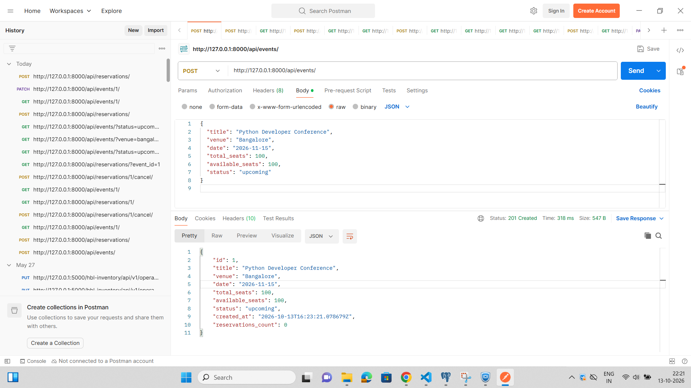
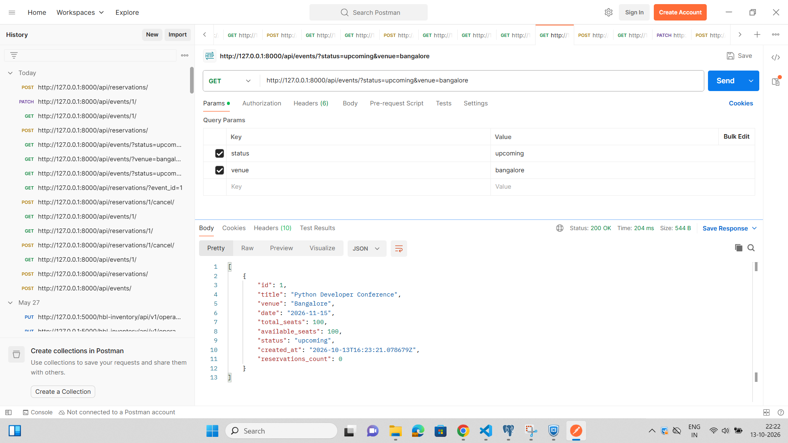
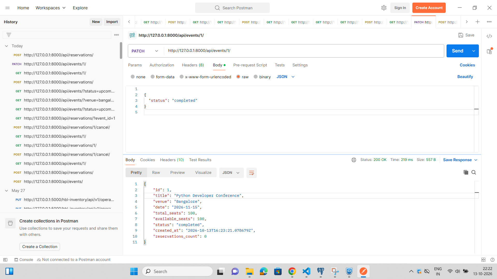
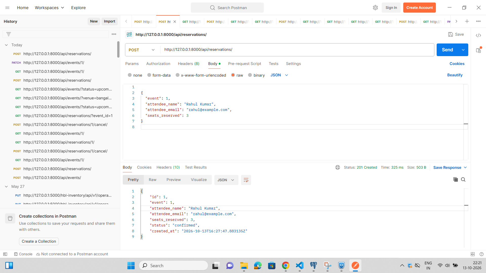
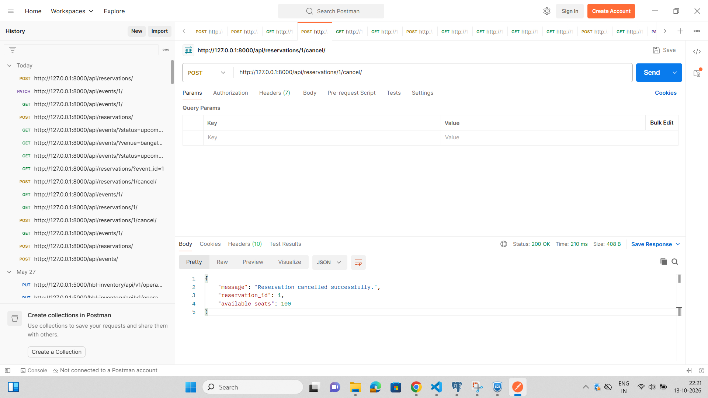
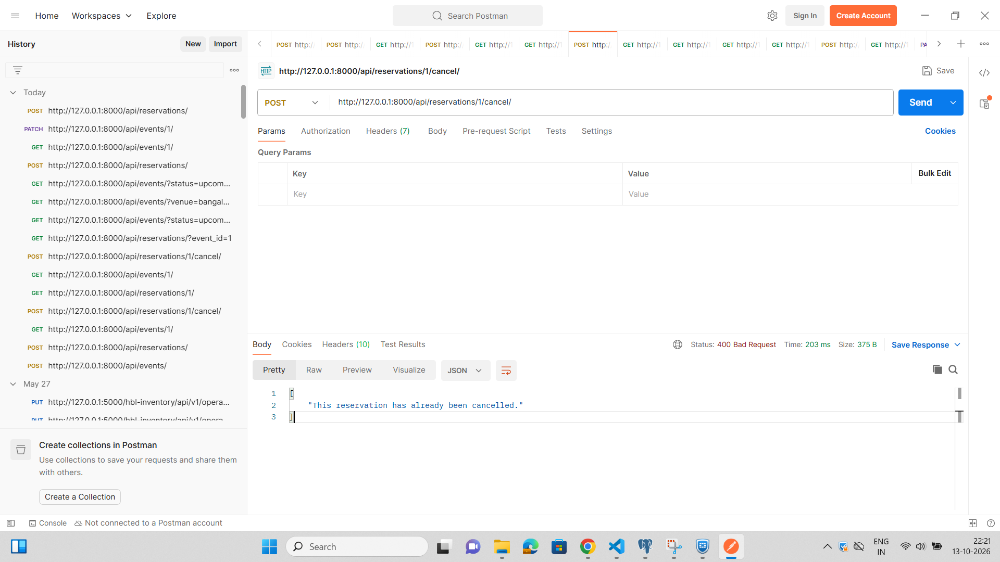
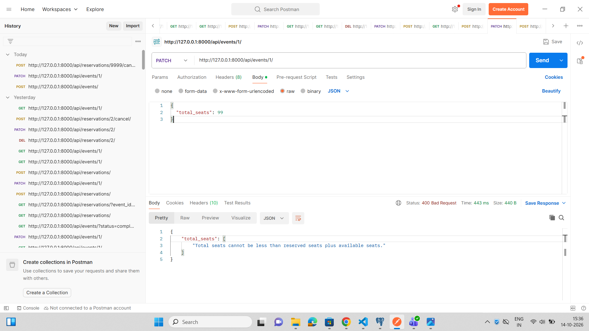
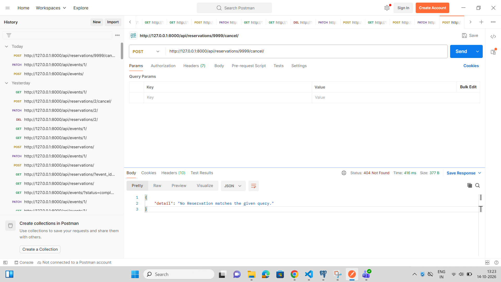
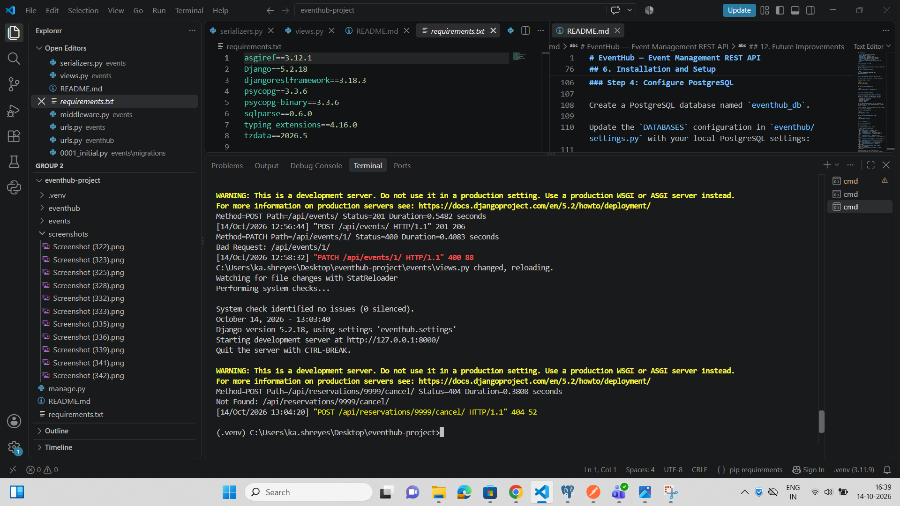

# EventHub — Event Management REST API

## 1. Project Overview

EventHub is a RESTful API built using Django and Django REST Framework for managing events and attendee reservations. It uses PostgreSQL as its database.

The API supports event creation and management, reservation processing, seat availability tracking, reservation cancellation, event filtering, and request logging.

## 2. Features

- Create, retrieve, update, and list events.
- Filter events by status and venue.
- Create attendee reservations for events.
- Track total seats and available seats.
- Prevent reservations that exceed available capacity.
- Validate event status before accepting reservations.
- Cancel reservations and restore available seats.
- Prevent duplicate reservation cancellation.
- Filter reservations by event ID.
- Preserve reservation history by preventing direct updates and deletions.
- Log HTTP method, request path, response status code, and request duration.

## 3. Technology Stack

- **Language:** Python 3.11
- **Framework:** Django 5.2
- **API framework:** Django REST Framework
- **Database:** PostgreSQL
- **Database adapter:** Psycopg
- **API testing:** Postman

## 4. Project Structure

```text
eventhub-project/
├── eventhub/
│   ├── settings.py
│   └── urls.py
├── events/
│   ├── migrations/
│   ├── models.py
│   ├── serializers.py
│   ├── views.py
│   ├── urls.py
│   ├── admin.py
│   └── middleware.py
├── manage.py
├── requirements.txt
└── README.md
```

## 5. Data Models

### Event

- `id`: Unique event identifier.
- `title`: Event title.
- `venue`: Event location.
- `date`: Event date.
- `total_seats`: Total event capacity.
- `available_seats`: Number of seats currently available.
- `status`: `upcoming`, `ongoing`, `completed`, or `cancelled`.
- `created_at`: Timestamp when the event was created.
- `reservations_count`: Number of confirmed reservations, included in API responses.

### Reservation

- `id`: Unique reservation identifier.
- `event`: Related event ID.
- `attendee_name`: Attendee's name.
- `attendee_email`: Attendee's email address.
- `seats_reserved`: Number of seats reserved.
- `status`: `confirmed` or `cancelled`.
- `created_at`: Timestamp when the reservation was created.

## 6. Installation and Setup

### Prerequisites

Install Python 3.11 and PostgreSQL. Ensure the PostgreSQL service is running.

### Step 1: Clone the repository

```bash
git clone <YOUR_GITHUB_REPOSITORY_URL>
cd eventhub-project
```

Replace the placeholder with your repository URL.

### Step 2: Create and activate a virtual environment

On Windows Command Prompt:

```bash
python -m venv .venv
.venv\Scripts\activate
```

### Step 3: Install dependencies

```bash
python -m pip install -r requirements.txt
```

### Step 4: Configure PostgreSQL

Create a PostgreSQL database named `eventhub_db`.

Update the `DATABASES` configuration in `eventhub/settings.py` with your local PostgreSQL settings:

- **Database:** `eventhub_db`
- **Username:** `postgres`
- **Host:** `localhost`
- **Port:** `5433`

Set your PostgreSQL password to the one configured on your machine. Do not commit database passwords or other secrets to GitHub.

If your PostgreSQL instance uses a different port, update the `PORT` value accordingly.

### Step 5: Apply migrations

```bash
python manage.py migrate
```

### Step 6: Start the development server

```bash
python manage.py runserver
```

The API is available at:

`http://127.0.0.1:8000/api/`

## 7. API Endpoints

All endpoints use the `/api/` prefix.

| Method | Endpoint | Description |
|---|---|---|
| POST | `/api/events/` | Create an event |
| GET | `/api/events/` | List events |
| GET | `/api/events/{id}/` | Retrieve an event |
| PATCH | `/api/events/{id}/` | Partially update an event |
| PUT | `/api/events/{id}/` | Update an event |
| GET | `/api/events/?status=upcoming` | Filter events by status |
| GET | `/api/events/?venue=bangalore` | Filter events by venue |
| GET | `/api/events/?status=upcoming&venue=bangalore` | Combine event filters |
| POST | `/api/reservations/` | Create a reservation |
| GET | `/api/reservations/` | List reservations |
| GET | `/api/reservations/{id}/` | Retrieve a reservation |
| GET | `/api/reservations/?event_id=1` | Filter reservations by event |
| POST | `/api/reservations/{id}/cancel/` | Cancel a reservation |

Reservation update and delete operations are intentionally disabled. Use the cancellation endpoint instead.

## 8. Example Requests

### Create an event

**POST** `/api/events/`

```json
{
  "title": "Django Testing Workshop",
  "venue": "Bangalore",
  "date": "2026-12-10",
  "total_seats": 50,
  "status": "upcoming"
}
```

The API initializes `available_seats` to `50` automatically.

### Create a reservation

**POST** `/api/reservations/`

```json
{
  "event": 2,
  "attendee_name": "Test User",
  "attendee_email": "testuser@example.com",
  "seats_reserved": 2
}
```

The API creates a confirmed reservation and decreases the event's available seats by two.

### Cancel a reservation

**POST** `/api/reservations/2/cancel/`

No request body is required.

A successful cancellation marks the reservation as cancelled and restores its reserved seats to the associated event.

## 9. Validation and Design Decisions

- Reservations require at least one seat.
- Reservations are accepted only for upcoming or ongoing events.
- Reservations cannot exceed available seats.
- Reservation creation uses a database transaction and row locking to protect seat availability during concurrent requests.
- Available seats are read-only through the event API and are managed by reservation operations.
- Event capacity validation prevents reducing total capacity below the current available seats plus confirmed reserved seats.
- Duplicate cancellation is rejected.
- Direct reservation updates and deletions are disabled to preserve reservation history.
- Invalid reservation IDs return a not-found response.
- Event filtering by venue is case-insensitive.
- Request logging records the HTTP method, request path, response status code, and processing duration.

## 10. Request Logging

The custom middleware in `events/middleware.py` logs request information to the Django server terminal.
Example:

```text
Method=GET Path=/api/events/1/ Status=200 Duration=0.2415 seconds
```

## 11. Testing

The API has been tested manually using Postman for:
### 1. Event Creation


### 2. Event Filtering


### 3. Event Status Update


### 4. Reservation Creation


### 5. Reservation Cancellation


### 6. Duplicate Cancellation Protection


### 7. Event Capacity Validation


### 8. Invalid Reservation ID


### 9. Request Logging Middleware



## 12. Future Improvements

- Add automated API tests using Django's test framework or pytest.
- Add authentication and permissions.
- Move database credentials into environment variables.
- Add pagination and API documentation.
- Deploy the API to a production environment.
